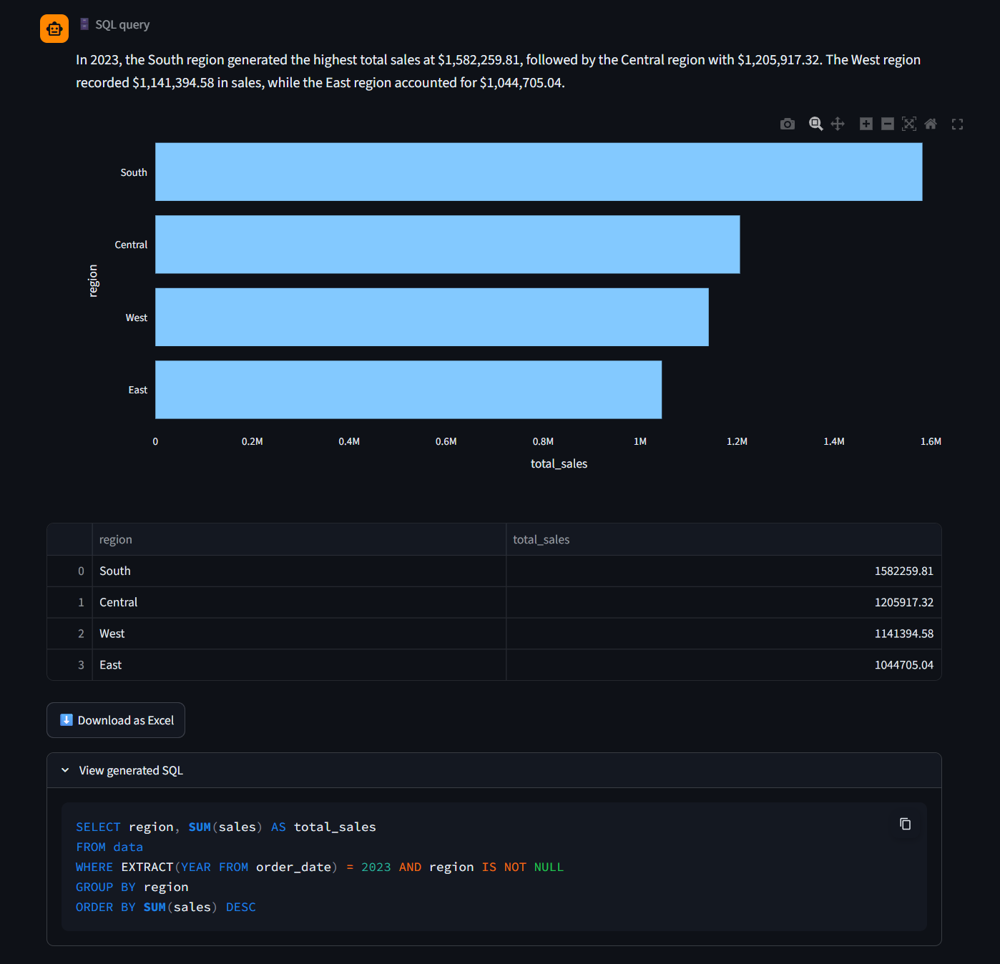
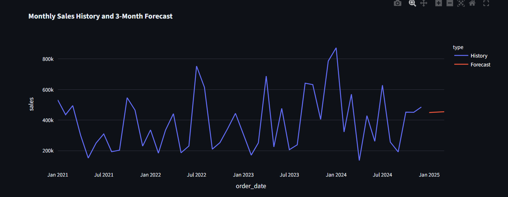
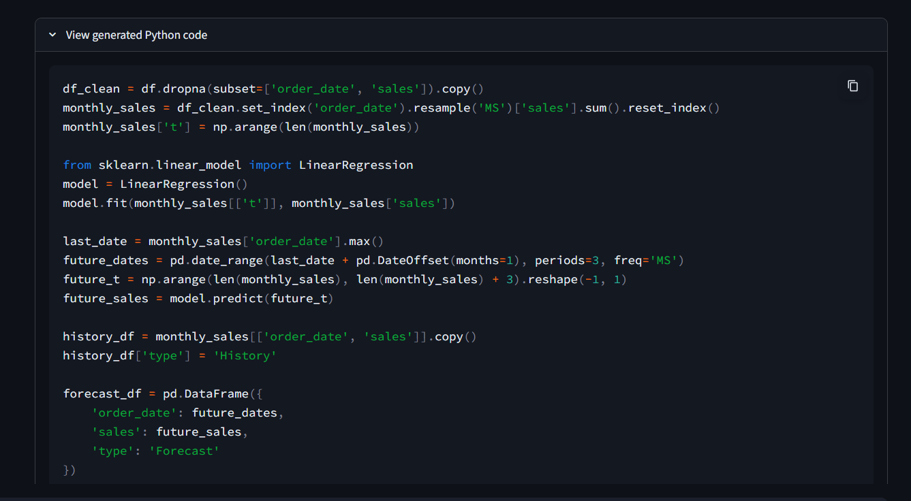
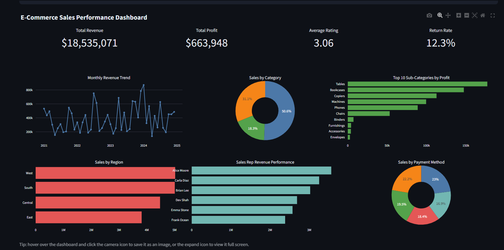
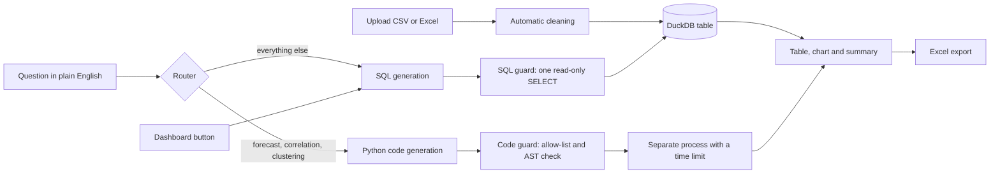

# 📊 AI Data Analyst Assistant

Upload a CSV or Excel file, ask questions in plain English, and get an answer with a chart, a short summary, and the exact SQL or Python code that produced it. Messy data is cleaned automatically, every query is checked for safety before it runs, and one click builds a dashboard.



## What it does

- **Automatic data cleaning** for messy files: prices stored as text (`$1,200`, `USD 59`), mixed date formats, typos in categories (`Furnitre`), impossible values (a 150% discount), duplicate rows and junk columns. A cleaning report shows exactly what was fixed.
- **Text-to-SQL** on DuckDB for questions like "Top 5 sales reps by profit", including follow-ups such as "now only for 2023".
- **Python mode** for what SQL can't do well: forecasts, correlations, outliers and clustering.
- **Dashboard generator**: one click asks the AI for a plan of KPIs and charts, runs every query through the same safety guard, and draws the result as a single picture.
- **Charts, summaries and Excel export** for every answer.
- **Transparent**: every answer lets you open the SQL or Python code behind it.







*The screenshots use a messy 5,190-row sales file that is not included in this repository. The repository contains a synthetic demo dataset instead (see below).*

## How it works



**Safety layers**
- **SQL:** only a single read-only `SELECT` is allowed. `DROP`, `DELETE`, `UPDATE`, `COPY` and similar are blocked. The dashboard queries pass through the same guard.
- **Python:** a static check blocks dangerous imports and calls, restricted builtins limit what the code can do, and the code runs in a separate process with a 30-second timeout.
- **Self-repair:** if generated SQL or code fails or is rejected, the error is sent back to the model so it can fix it (up to 2 retries).
- **Resilience:** if the main model is overloaded or out of quota, requests fall back to a backup model. Failed dashboard panels are skipped instead of breaking the page.

## Results

| Test | Result |
|---|---|
| SQL benchmark, first run (46 questions) | 87.0% (40/46) |
| SQL benchmark after error analysis (same 46 questions) | 100% (46/46), average 8.0 s |
| SQL, 10 **unseen** questions | 10 / 10, average 2.5 s |
| Safety: unsafe or unanswerable requests refused | 6 / 6 |
| Python mode, first run (8 questions) | 87.5% (7/8) |
| Python mode after clarifying one ambiguous question | 8 / 8, average 6.5 s |

Full reports are in [`results/`](results/).

**How to read these numbers**
- The first run is the real baseline. Of its 6 SQL failures, 4 came from a test that was too strict (right answer, but an extra column was expected) and 2 were genuine model mistakes: ignoring a filter word, and returning an empty group. I fixed the test, added general prompt rules, and re-ran.
- The 100% on the 46 questions is on questions I tuned against. The 10 unseen questions are the fairer number.
- Ten and eight questions are small samples. They are evidence, not proof.
- In Python mode, 3 of the 8 answers needed the automatic retry, which is why the retry mechanism exists.
- Python answers are checked on numbers and structure, for example a correlation value or "exactly 3 forecast rows". The accuracy of the forecast itself is not evaluated, and the app labels forecasts as a simple trend estimate.
- Response times depend on the free API tier and vary from run to run.
- The benchmark questions were written for the 5,190-row file that is not in this repository.

## Run it yourself

```bash
git clone https://github.com/gadodiaananya-dev/ai-data-analyst.git
cd ai-data-analyst
python -m venv venv
venv\Scripts\activate          # Mac/Linux: source venv/bin/activate
pip install -r requirements.txt
```

1. Get a free API key at [aistudio.google.com](https://aistudio.google.com).
2. Copy `.env.example` to `.env` and paste your key into it. Never commit `.env`.
3. Start the app:

```bash
python -m streamlit run app.py
```

Click **Try it with the demo dataset** (a small synthetic and deliberately messy sales file, created by `make_demo_data.py`), or upload your own file.

### Tests and benchmarks

```bash
python -m pytest -q                                                          # unit tests, no API key needed
python evaluate.py --data data/demo_sales.csv                                # SQL benchmark
python evaluate.py --questions tests/eval_unseen.json --tag unseen --fresh   # unseen SQL questions
python evaluate_python.py --data data/demo_sales.csv                         # Python-mode benchmark
```

Scores on the demo file can differ from the table above, because the questions were written for a different dataset.

## Project structure

```
app.py                  Streamlit interface
evaluate.py             SQL accuracy benchmark
evaluate_python.py      Python-mode benchmark
make_demo_data.py       creates the synthetic demo dataset
src/
  cleaner.py            automatic data cleaning
  data_loader.py        reads files and loads them into DuckDB
  profiler.py           dataset and column summaries
  schema.py             describes the table to the AI
  llm_engine.py         text-to-SQL, retries, summaries
  sql_safety.py         read-only SQL guard
  router.py             chooses SQL or Python mode
  python_engine.py      text-to-Python with retries
  python_safety.py      static code checker
  python_runner.py      runs code in a separate process
  sandbox_worker.py     restricted execution environment
  dashboard.py          dashboard plan, safe building and drawing
  charts.py             automatic chart choice
  export.py             Excel export
tests/                  unit tests and benchmark questions
results/                evaluation reports
data/demo_sales.csv     synthetic demo data
```

## Limitations

- **Not a hardened sandbox.** Python execution uses several protective layers, but a determined attacker could find a way around a blocklist. A production version should run the code in an isolated container with no network and memory limits.
- Cleaning rules are tuned for sales-style data (prices, dates, regions, categories). Other datasets are handled by the general rules only.
- Follow-up questions work for SQL answers, not for Python answers.
- The dashboard is a quick overview, not a Power BI replacement. In the example above, the "Sales by Region" chart runs into the chart beside it and the donut charts have no labels. These are known layout issues.
- With the free Gemini tier, requests can be slow or rate-limited, and Google may use free-tier data to improve its products, so do not upload private data.
- Tested on one main dataset.

## Built with

Python, Streamlit, DuckDB, pandas, scikit-learn, Plotly, Google Gemini API, pytest.
